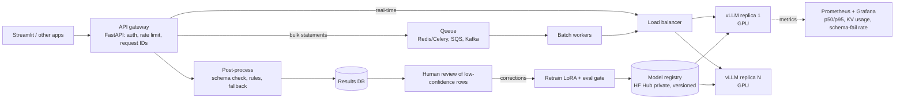

# Serving the Fin AI SLM — and what the KV cache actually is

Team-friendly explainer for `serving/`. Goal: take a fine-tuned Qwen2.5-0.5B/1.5B-Instruct (bank statement narration → 10-field JSON) and serve it at low latency to a Streamlit UI, then understand what you'd change to scale it.

> No benchmark numbers here on purpose. Every latency/throughput figure depends on GPU, prompt length, batch size and vLLM version — **measure it** with `serving/client.py` / the Streamlit metrics.

---

## 1. The big picture

```
Colab (train, your notebook) ──► adapter  ──► merge (export_weights.py) ──► merged fp16 safetensors
                                    │                                            │
                                    ▼                                            ▼
                             HF Hub (private)  ◄─────────────────────────  HF Hub (private)
                                                                                 │
                         colab_serve.ipynb:  vllm serve <merged> ──► cloudflared tunnel ──► Streamlit on laptop
```

Rule of thumb: **the model runs in its own server process; the app is just an HTTP client.** Streamlit reruns the whole script on every click; loading a model inside it would be slow and would not batch requests.

---

## 2. Life of one request: prefill vs decode

When `client.parse("NACH-DR-BAJAJFIN-1234567890")` hits vLLM:

1. **Tokenize** the chat template: system prompt (`SYS`) + user narration + assistant header. Our prompt is short (tens of tokens; count it with the tokenizer).
2. **Prefill** — the model processes *all prompt tokens in one forward pass* (parallel, compute-bound). It produces the first output token and stores each layer's **keys and values** for every prompt token → the **KV cache**.
3. **Decode** — generate output tokens **one at a time**. Each step only computes the new token, and attends to all previous tokens by reading their K/V from the cache instead of recomputing them. Decode is **memory-bandwidth-bound** (read weights + KV cache every step).
4. Stop at end-of-sequence or `max_tokens=200`. Our JSON is roughly 60–100 tokens, so **decode dominates latency** for this task.

Useful latency terms:
- **TTFT** (time to first token) ≈ queueing + prefill.
- **TPOT / ITL** (time per output token) ≈ one decode step.
- **End-to-end latency** ≈ TTFT + (output tokens × TPOT). Shorter JSON = faster.

---

## 3. The KV cache, and why it's the memory bottleneck

Without a cache, generating token *n* would recompute attention K/V for all *n−1* previous tokens → quadratic waste. With the cache, we store them once. The price is GPU memory, and it grows with **every token of every concurrent request**.

**Formula (per token):**

```
KV bytes per token = 2 (K and V) × num_layers × num_kv_heads × head_dim × bytes_per_value
head_dim = hidden_size / num_attention_heads
```

Values below are from the models' real `config.json` on Hugging Face ([0.5B](https://huggingface.co/Qwen/Qwen2.5-0.5B-Instruct/blob/main/config.json), [1.5B](https://huggingface.co/Qwen/Qwen2.5-1.5B-Instruct/blob/main/config.json)), fp16 = 2 bytes:

| Model | layers | hidden | attn heads | **kv heads** | head_dim | KV / token | 512-token request | full 32,768 ctx |
|---|---|---|---|---|---|---|---|---|
| Qwen2.5-0.5B-Instruct | 24 | 896 | 14 | 2 | 64 | 2·24·2·64·2 = **12,288 B = 12 KiB** | 6 MiB | 384 MiB |
| Qwen2.5-1.5B-Instruct | 28 | 1536 | 12 | 2 | 128 | 2·28·2·128·2 = **28,672 B = 28 KiB** | 14 MiB | 896 MiB |

Why so small? **Grouped-Query Attention (GQA)**: Qwen2.5 uses only 2 KV heads shared across 14 (or 12) query heads. With full multi-head attention it would be 7× (0.5B → 84 KiB/token) and 6× (1.5B → 168 KiB/token) bigger.

**Why it's still the bottleneck:** weights are a fixed cost (~1 GB fp16 for 0.5B, ~3 GB for 1.5B), but KV memory = per-token size × tokens × concurrent requests. The KV pool size decides **how many requests can run at once**, which decides throughput.

Back-of-envelope (arithmetic, not a benchmark): if vLLM ends up with ~5 GiB of KV pool for 0.5B, that's 5 GiB / 12 KiB ≈ 437k tokens ≈ ~850 full 512-token sequences. vLLM prints the real numbers at startup — look for the `KV cache` and `Maximum concurrency` lines in `vllm.log`.

---

## 4. PagedAttention (how vLLM stores the KV cache)

Naive servers reserve one contiguous chunk per request sized for the *max* length → most of it is wasted (fragmentation). vLLM's **PagedAttention** splits the KV cache into small fixed-size **blocks** (like OS memory pages); a request gets blocks on demand and a block table maps logical → physical blocks. Result: near-zero waste, more requests fit, and blocks can be **shared** (that's what makes prefix caching cheap).
Paper: Kwon et al., *Efficient Memory Management for Large Language Model Serving with PagedAttention*, [arXiv:2309.06180](https://arxiv.org/abs/2309.06180). Docs: [vLLM](https://docs.vllm.ai/).

## 5. Continuous batching

GPUs are most efficient when doing many sequences per step. Static batching waits for a whole batch to finish; **continuous (in-flight) batching** re-forms the batch **every decode step**: finished requests leave, new ones join immediately. That's why `client.parse_batch` sends lines **concurrently** — the server merges them into the same GPU steps. A 1.5K-statement bulk job should always be sent as many concurrent requests (or via the offline `LLM.chat` API), never one-by-one.

## 6. Prefix caching (our fixed system prompt)

Every request starts with the **identical** `SYS` prompt. With `--enable-prefix-caching` (default-on in recent vLLM), the KV blocks for that prefix are computed once and **reused** by later requests — skipping part of the prefill. Keep it effective by:
- putting fixed text first and the variable narration last (we do);
- never adding timestamps/IDs to the system prompt;
- using the exact same string as training (`serving/schema.py`).
For a short prompt the gain is modest; it matters more if you add few-shot examples to the prompt.

## 7. Guided / structured decoding

At each decode step vLLM masks tokens that would violate our JSON schema (backends: xgrammar / guidance), so the output **always parses and matches the enums**. It does **not** make the values correct — that's the fine-tune's job — so we still validate with `jsonschema` and score field accuracy in eval.

API (see vLLM [structured outputs docs](https://docs.vllm.ai/en/latest/features/structured_outputs.html)):
- **Current vLLM (≥ 0.12):** `extra_body={"structured_outputs": {"json": SCHEMA}}` ← our default.
- **Older vLLM (< 0.12):** `extra_body={"guided_json": SCHEMA}` (removed in 0.12). Set `SLM_GUIDED=guided_json`.
- OpenAI-style `response_format={"type":"json_schema", ...}` also works (`SLM_GUIDED=response_format`).
- Tip: evaluate with `SLM_GUIDED=none` too, to see how good the fine-tune is on its own.

## 8. Quantization for serving

| Option | What | When |
|---|---|---|
| fp16 merged | no quantization | default; 0.5B/1.5B fit a T4 easily |
| **AWQ** (4-bit weights) | `--quantization awq` with an AWQ checkpoint | more replicas per GPU / bigger KV pool; re-run eval after quantizing |
| **FP8** | weights (and optionally KV cache, `--kv-cache-dtype fp8`) | needs newer GPUs (Ada/Hopper, e.g. L4/H100); not T4 |
| **GGUF** (llama.cpp / Ollama) | CPU / laptop inference | demo backup without a GPU; slower |

Always re-check accuracy after quantizing — small models can be more sensitive.

## 9. Tuning knobs (`serving/serve_vllm.sh`)

- `--gpu-memory-utilization` — fraction of GPU memory vLLM pre-allocates. After weights + activation workspace, the rest is the KV pool. Higher → more concurrency. 0.6 is polite on shared Colab; 0.85–0.9 on a dedicated GPU.
- `--max-model-len` — max prompt+output tokens per request. 512 is plenty for one narration. Lower = smaller worst case per sequence.
- `--max-num-seqs` — max sequences in one batch step. Higher → throughput up, per-request latency may rise.
- `max_tokens` (client) — cap output length; 200 covers our JSON.
- `temperature=0` — greedy, deterministic extraction.
- `--dtype half` — T4 has no bf16.

## 10. Latency vs throughput, and how to measure

- **Latency** = how long *one* user waits (UI demo). **Throughput** = lines/sec or tokens/sec for *everyone* (bulk statements). Bigger batches raise throughput and usually raise per-request latency a bit — pick based on the use case.
- Report **p50 and p95** latency (not just the mean), **lines/s**, and **output tokens/s**. The Streamlit app and `python serving/client.py` print these.
- Measure with a warm server (first requests include warm-up), a fixed set of lines, and a few concurrency levels (1, 8, 32).
- vLLM exposes Prometheus metrics at `/metrics` (TTFT, TPOT, KV cache usage, queue length).

## 11. Where to store the weights

Recommendation:
- **Hugging Face Hub, private repos — primary.** Push **both**: the **LoRA adapter** (small, the true training artifact, easy to version per experiment) and the **merged fp16 model** (what vLLM serves and what AWQ/GGUF are made from). `serving/export_weights.py` does both. Use **safetensors** (no pickle code execution, fast memory-mapped loading). Tag/branch versions (e.g. `v0.1-0.5b-sft`, `v0.2-0.5b-dpo`) and keep eval scores in the model card.
- **Weights & Biases Artifacts — optional, for lineage:** link run → config → data → adapter. Nice for experiment tracking; serve from HF.
- **Google Drive — scratch only** (Colab checkpoints between sessions); not the source of truth.

## 12. Scaling it up (production shape)



- **Replicas:** one vLLM per GPU, stateless; scale replicas with an autoscaler on queue depth / GPU utilization (Kubernetes, or managed: HF Inference Endpoints, Modal, RunPod). Scale to zero off-hours.
- **Two traffic modes:** real-time single lines vs bulk jobs via a queue with large concurrent batches.
- **Guardrails:** schema validation, deterministic rules (amount/ref regexes), low-confidence → human review or bigger model.
- **Monitoring:** latency p50/p95, throughput, KV cache usage, schema-fail rate, per-field drift; log inputs/outputs with PII masked.
- **Data flywheel:** reviewed corrections → training set → retrain → must beat current model on the eval set (incl. OOD) → canary rollout → promote. Rollback = point to the previous version.

## References
- vLLM docs: https://docs.vllm.ai/ (OpenAI-compatible server, structured outputs, prefix caching, engine args)
- PagedAttention paper: https://arxiv.org/abs/2309.06180
- PEFT `merge_and_unload`: https://huggingface.co/docs/peft/
- HF Hub uploads: https://huggingface.co/docs/huggingface_hub/guides/upload
- safetensors: https://huggingface.co/docs/safetensors/
- Ollama import (GGUF): https://docs.ollama.com/import
